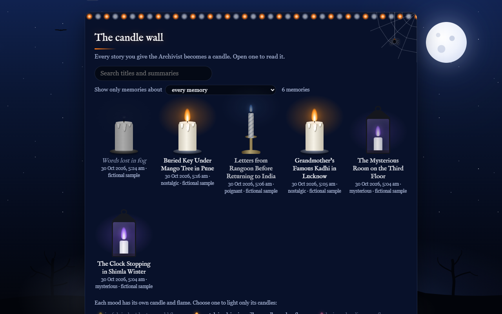
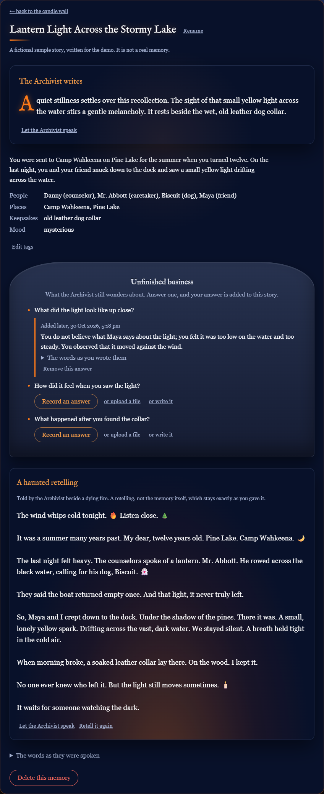
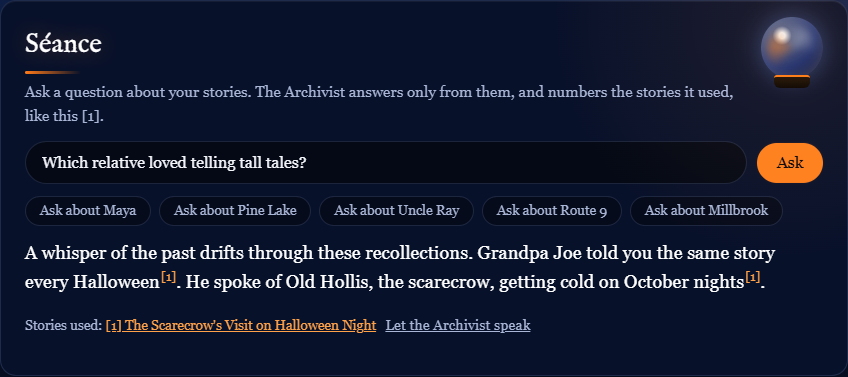
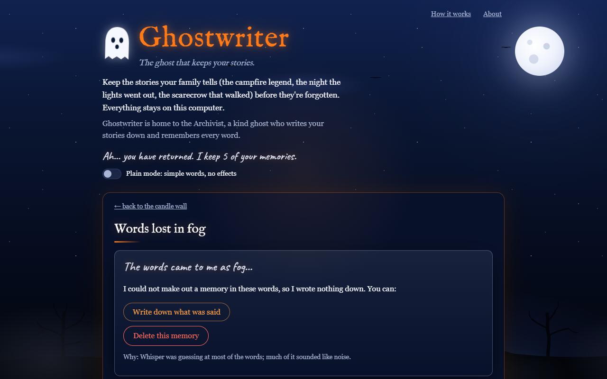

# Ghostwriter: the ghost that keeps your stories

> A ghost lives in your laptop. Tell it your stories and it writes them down,
> keeps them, and haunts you with them later.

Keep the stories your family tells (the campfire legend, the night the lights went out, the scarecrow
that walked) before they're forgotten. **Ghostwriter** is a memory keeper with a spooky skin and a
warm heart, and it is home to **the Archivist**, a kind ghost who listens to a story told out loud
(or reads one you write down), writes it down, keeps it on a candle wall, asks about the parts you left out, and answers questions about your stories without ever
making things up.

Everything runs on your own laptop with open models: **Gemma 4** and **EmbeddingGemma** (through
Ollama), **Whisper** (through faster-whisper) and **Piper**. Turn the Wi-Fi off and it still works.

Built for the DEV **Hacktoberfest Open-Source AI Challenge, Week 4: "Ghost in the Machine"**.
Project page: **[theghostwriter.tech](https://theghostwriter.tech)**.



| A story, with an answer added later | The Seance answers only from your stories | Unclear words are never made into a memory |
|---|---|---|
|  |  |  |

_Demo video: [PLACEHOLDER]_

## What it does

- **Listens, in English.** Record in the browser (with a live clock, a level meter, Stop and Cancel)
  or upload a voice note (wav, mp3, m4a, webm, ogg). Whisper's English model (`small.en`) writes it
  down, guided by a glossary of the names already in your archive, so a name corrected once is heard
  right the next time. It was chosen by measuring eight setups on test clips with background noise,
  other voices, a campfire's rumble, a far-off voice and rushed, muffled speech (Listening, below).
- **Or write it down.** No microphone, a noisy room, or a story that needs a second try? Write it on
  a page of ruled paper, with the browser's spell check and an offline autocorrect that fixes common
  typos and missing apostrophes as you type ("teh" -> "the", "dont" -> "don't"; Backspace straight
  after puts your word back; it can be switched off). The draft is kept if you leave the page. Gemma
  reads a written story exactly like a recording. Answers to questions can be written too.
- **Won't invent a memory from noise.** Before Gemma reads anything, a quality check looks at
  Whisper's own confidence. A recording that came out as fog is marked *unclear*, with no made-up
  title or summary, and the page offers to write down what was said instead, or delete it.
- **Remembers.** Gemma 4 turns each transcript into validated JSON: a title, a short summary, people,
  places, eras, a mood, keepsakes (objects, recipes, sayings) and follow-up questions. It describes
  only what was said (talk about "the transcript" is rejected), leaves out words it can't make sense
  of and says so, and gives the same answer when re-reading the same words.
- **Unfinished business.** The Archivist asks about what you left out: who else was there, how it
  smelled, what happened next. It never asks what the story already says, or what nobody knows.
  Answer by voice or in writing, and the answer is **added to that story**.
- **Seance.** Ask the archive a question. It finds the right stories by keywords (SQLite FTS5) and
  by meaning (EmbeddingGemma), so "Which relative loved telling tall tales?" finds the scarecrow story
  (Grandpa Joe told it every Halloween) without sharing a word with it, and
  Gemma answers only from them, with numbered sources. If nothing matches, Gemma isn't asked: *"That
  memory was never given to me."*
- **Ink, not a wall of text.** Gemma's words stream to the page as they are written and fade in like
  ink; citations appear as small numbers, never as raw markers.
- **Your stories stay yours to fix.** Rename a story, correct its words (Whisper's original is kept)
  and let the Archivist re-read it, add, rename, merge or remove tags, change the mood, or delete a
  story (with Undo).
- **Always says what it's doing.** Processing shows its steps, a clock and how long is left (learnt
  from how long it took before on your computer); slow writing can be cancelled.
- **Candle wall.** Every story is a candle under a moonlit sky. Its mood picks the candle and flame:
  a jack-o'-lantern (joyful), a dripping pillar (nostalgic), a clay oil lamp (loving), a twisted taper
  (poignant), an iron lantern (mysterious), a skull (eerie). A story you haven't opened for a while
  burns low; opening it relights it. Search titles and summaries, filter by person, place, era,
  keepsake or mood; the filter stays in the address.
- **Whispers.** On launch the Archivist sometimes murmurs a line from a faded story, and says which.
- **Ghost voice.** The Archivist can speak, using Piper text-to-speech with ffmpeg effects. It starts
  with the first sentence while the rest is made; notes are voiced in advance. Optional.
- **Haunted retelling.** One click retells a memory as a campfire ghost story, with a few emojis to
  set the mood (the voice skips them), labelled as a retelling and stored separately; the original is
  never changed.
- **Memory book.** Every story, with its answers, notes and retellings, as one self-contained page
  (`/book`) to print, save as a PDF, or keep.
- **Plain mode.** One switch for neutral wording, simple cards and no animation or decoration.
  Nothing is hidden: the Archivist's note becomes the "AI note".
- **Explains itself.** A "How it works" guide (which comes back from the header), an About panel that
  says what each feature does and which local tools are working, and a short hint under every
  feature.

It does **not** clone anyone's voice. To hear the storyteller, you play back their original
recording.

## Quick start (Windows)

You need Python 3.11+ (python.org), ffmpeg and Ollama.

```powershell
winget install --id Gyan.FFmpeg -e
winget install --id Ollama.Ollama -e
ollama pull gemma4:e4b
ollama pull embeddinggemma:300m-qat-q8_0
powershell -ExecutionPolicy Bypass -File scripts\setup.ps1
```

`setup.ps1` creates `.venv`, installs the pinned packages, downloads the Whisper weights and the
Piper voice, and runs the self-check. It is the only step that needs the internet, apart from the
installs and the model pulls above. The embedding model is optional: without it the Seance searches
by keywords only.

If winget's download fails (it did on the development machine with `0x80072eff`), run
`winget show --id <id> -e`, download the installer URL it lists with `curl.exe`, compare the SHA256
it lists, and run the installer yourself.

Check everything (with Wi-Fi off, if you like):

```powershell
.venv\Scripts\python.exe -m ghostwriter.selfcheck --ping
```

## Run

```powershell
powershell -ExecutionPolicy Bypass -File scripts\run.ps1    # your real archive, in data\
powershell -ExecutionPolicy Bypass -File scripts\demo.ps1   # fictional sample stories, in demo-data\
```

Run them from the project folder, then open http://127.0.0.1:8000 in Chrome or Edge. The first run
of `demo.ps1` asks Gemma to read the two fictional campfire samples (about half a minute each). "Remove sample stories" on
the candle wall takes them out again.

### Ghost voice (optional)

1. Download `piper_windows_amd64.zip` from the
   [Piper 2023.11.14-2 release](https://github.com/rhasspy/piper/releases/tag/2023.11.14-2) and unzip
   it, for example to `C:\Users\<you>\Tools\piper`.
2. Add `GW_PIPER_BIN=C:\Users\<you>\Tools\piper\piper.exe` to `.env` (or put that folder on PATH).
3. `scripts\setup.ps1` downloads the voice (`en_GB-northern_english_male-medium`) into `models\piper\`.

Without Piper, everything else works and the "speak" buttons don't appear.

## Listening (Whisper)

Ghostwriter listens in **English** with Whisper's English-only `small.en` (int8, 464 MB). Before
Whisper hears a recording, ffmpeg makes a lightly cleaned-up copy (rumble and hiss outside the voice
cut, steady noise gently reduced, volume evened out); the original is kept untouched for playback.

That setup was chosen by measurement. Three passages (about 40 s each, read by Piper) were mixed six
ways and every setup transcribed all 18 clips; the score is the share of words it got wrong (lower is
better):

| Setup | Clean | Steady noise | Other voices | Campfire rumble | Far and quiet | Rushed, muffled | All 18 | Seconds per clip |
|---|---|---|---|---|---|---|---|---|
| Before: multilingual `small`, language detected | 5.6% | 7.1% | 34.6% | 6.0% | 4.8% | 11.1% | 11.5% | 17.5 |
| `small.en` | 4.4% | 4.9% | 32.0% | 4.8% | 4.0% | 8.7% | 9.8% | 9.7 |
| **`small.en` + clean-up (used)** | 3.5% | 5.9% | 31.7% | 4.0% | 3.7% | 7.1% | **9.3%** | 9.9 |

Five other setups did worse (volume levelling alone, decoder tweaks, the multilingual model told it
was English); PROGRESS.md has all eight. Other people talking over the storyteller is still the
hardest case. Names Whisper has never heard are the most common mistake ("Camp Wahkeena" came out
"Camp Joaquin"), which is what the glossary is for: with the archive's names in it, the same clip came
out "Camp Wahkeena", even rushed and muffled.

`GW_WHISPER_MODEL` in `.env` picks the size (`tiny.en`, `base.en`, `small.en`, `medium.en`; the
multilingual sizes work too). Bigger hears better and is slower; after changing it, run
`scripts\setup.ps1` once to download that size. The About panel lists the downloaded sizes.

## Offline and private

- Ghostwriter makes no requests outside `127.0.0.1`. Fonts, scripts and styles are bundled; there are
  no CDNs, analytics, accounts or external APIs. (In the browser's network panel, every request goes
  to the local server.)
- Gemma and EmbeddingGemma run in Ollama on this machine. Whisper and Piper load their weights from
  disk.
- The server listens on **`127.0.0.1` only**, so nothing else on your network can reach it. To open
  it from another device you would change `--host 127.0.0.1` in `scripts\run.ps1` to `0.0.0.0`; don't,
  unless you trust everyone on that network: there is no login, and every story would be readable
  and deletable by them.
- The health check (About panel, `/api/health`) shows paths relative to the project or to `~`, so it
  never shows your Windows user name.
- Honest note: the **Ollama** server program itself, when online, asks ollama.com for model
  recommendations and logs a warning when it can't. That is Ollama's behaviour, not Ghostwriter's, and
  it doesn't affect anything with the network off.

### Where your data lives

| What | Where |
|---|---|
| Stories, transcripts, tags, questions, search vectors (SQLite) | `data\ghostwriter.db` |
| Original and normalised recordings | `data\audio\` |
| Cached ghost-voice audio | `data\tts\` |
| Whisper and Piper weights | `models\whisper\<size>\`, `models\piper\` |
| Gemma and EmbeddingGemma weights | Ollama's model folder (`%USERPROFILE%\.ollama\models`, or wherever `OLLAMA_MODELS` points) |

`data\`, `demo-data\` and `models\` are git-ignored. Avoid keeping the project inside a cloud-synced
folder (such as OneDrive) if your recordings should stay on this machine.

## Architecture

```
 Browser  (plain HTML/CSS/JS from 127.0.0.1, fonts bundled)
   |  record / upload                     ^  Server-Sent Events: tokens and citations, as written
   v                                      |
 FastAPI (uvicorn) ------------------------+
   |
   |-- api/stories.py  upload (ffprobe check first), written stories, edit, re-read, delete with undo
   |-- pipeline.py     one job at a time; each step saved before the next; retry resumes
   |     |-- audio.py       ffprobe check, ffmpeg -> 16 kHz mono WAV (the original is kept)
   |     |-- transcribe.py  faster-whisper in English: glossary, word probabilities, quality gate
   |     '-- llm.py         Ollama /api/chat -> Gemma 4: JSON schema, validation, one repair
   |-- db.py         SQLite: stories, entities, questions, vectors, timings; FTS5 trigram index
   |-- search.py     keywords (BM25) + meaning (embed.py, EmbeddingGemma), reciprocal-rank fusion
   |-- prompts.py    every prompt and the Archivist's persona, in one place
   |-- tts.py        Piper -> ffmpeg ghost effects -> cached WAV parts
   |-- trash.py      delete with a 10-second undo
   |-- whispers.py   lines from the most faded stories
   |-- export.py     the self-contained memory book
   '-- selfcheck.py  which local services are available
```

[HOW_IT_WORKS.md](HOW_IT_WORKS.md) explains the design decisions in plain language.

## Measured performance

Intel i7-13620H, 16 GB RAM, integrated graphics only (everything on the CPU):

| What | Result |
|---|---|
| Whisper `small.en` int8 (with the clean-up) | about 15 s per minute of audio (40 s test clips in 9-12 s) |
| A clear 11 s clip, upload to finished story | 46 s (transcribing, reading, checking questions, writing the note) |
| Gemma 4 e4b generation | 10-19 tokens/s on replies over 50 tokens; 15.8 s to load the model cold |
| Seance answer | first words after 7-24 s, complete in 11-29 s; "never given to me" in 0.1 s |
| Meaning search (EmbeddingGemma) | 46-80 ms per question; 6 stories embedded in 3.3 s |
| Ghost voice | first sentence of a new text in 2.3 s; a note voiced in advance starts in 0.1 s |
| Haunted retelling | about 30 s to write ~140 words |

## Limitations

- **It is slow on a CPU.** A Seance answer takes seconds to start. Streaming makes the wait feel like
  part of the ritual, but it is still a wait. `gemma4:e2b` is faster and less articulate.
- **Whisper mishears names it hasn't heard before** ("Camp Wahkeena" came out "Camp Joaquin" until
  the name was in the archive). Correct it once in the tag editor, or use a bigger Whisper size.
- **Other voices talking over the storyteller** still cost about a third of the words. Record
  somewhere quiet, or write the story down.
- **A noisy recording stays unclear.** The quality check stops it from becoming a made-up memory,
  but it can't recover words that aren't there; record somewhere quiet, close to the microphone.
- **English only.** Whisper listens in English and the voice is an English Piper voice. (Hindi and
  Hinglish were tried and dropped: the speech model that runs at a usable speed on a CPU got too many
  words wrong.)
- **Windows first.** The scripts are PowerShell. The Python code uses `pathlib` and should run
  elsewhere, but only Windows has been tested.
- **Single user, no login.** It binds to `127.0.0.1` for that reason.
- **Piper's GitHub repository is archived;** the 2023 Windows build still works.

## Configuration

Copy `.env.example` to `.env`. Model names, paths, the Whisper size, the
embedding model, the longest recording allowed, and feature flags (ghost voice, plain mode by
default) are documented there, with the prefix `GW_`.

## Development

```powershell
.venv\Scripts\python.exe -m pip install -r requirements-dev.txt   # adds Playwright for the browser test
.venv\Scripts\python.exe -m pytest                                # 137 tests
.venv\Scripts\python.exe -m ghostwriter.transcribe a.wav          # Whisper timing and quality on one file
.venv\Scripts\python.exe -m ghostwriter.tts "Hello"               # the ghost voice on one line
```

Most tests fake Gemma and Whisper, so they run without the models. One asks the real EmbeddingGemma
when it is pulled ("tall tales" must find the scarecrow story by meaning alone). `tests/test_smoke.py` drives the real
page in your installed Google Chrome (no browser download) through upload, rename, tags, an answer,
the Seance, the memory book, a bad file, writing a story (autocorrect, Backspace to undo a fix, the
kept draft, a written answer), delete and undo, plain mode, the microphone (Chrome's fake microphone)
and a check that no decoration covers text at 390 and 1280 px.

[PROGRESS.md](PROGRESS.md) is the build log: decisions, known issues and every measurement.
[PLAN.md](PLAN.md) is the original plan.

## Memory book export

"Open the memory book" on the candle wall (or http://127.0.0.1:8000/book) gives every finished story
as one self-contained HTML page: fonts embedded, nothing fetched from anywhere, answers under their
questions. Print it, save it as PDF, or keep the file; it opens in any browser without Ghostwriter.
Recordings stay in `data\audio\`. From the command line:
`.venv\Scripts\python.exe -m ghostwriter.export memory-book.html`.

## Landing page (.tech)

`docs/` is a small static site (no build step, fonts bundled), live at [theghostwriter.tech](https://theghostwriter.tech).
`docs/book.html` is a real memory book made from fictional sample stories, so visitors can read the
ghost's output, and `docs/screenshots/` holds the screenshots above. To remake the book (the exporter
refuses to put real stories in `docs/`):

```powershell
$env:GW_DATA_DIR = "demo-data"; .venv\Scripts\python.exe -m ghostwriter.export docs\book.html
```

1. In `docs/index.html`, replace the demo-video box (`TODO(you)`).
2. Push the repo to GitHub, then **Settings > Pages > Deploy from a branch > `main` / `/docs`**.
3. Claim the free .tech domain at hacktoberfest.com/my/promos (free for the first year; it renews at a
   cost, so check the auto-renew setting).
4. In **Settings > Pages > Custom domain**, enter the domain (GitHub adds `docs/CNAME`). At the
   domain's DNS, point `www` (CNAME) to `aayush657.github.io` and the bare domain (A records) to
   GitHub Pages' addresses `185.199.108.153`, `185.199.109.153`, `185.199.110.153`, `185.199.111.153`.
   Then tick **Enforce HTTPS**.

## Credits

Every model, library, font and tool this project relies on:

| Piece | By | Licence |
|---|---|---|
| Gemma 4 (`gemma4:e4b`) | Google DeepMind | Apache 2.0 (checked with `ollama show gemma4:e4b --license`) |
| EmbeddingGemma (`embeddinggemma:300m-qat-q8_0`) | Google DeepMind | Gemma Terms of Use (checked with `ollama show --license`) |
| Ollama | Ollama | MIT |
| Whisper model weights | OpenAI (CTranslate2 conversion by SYSTRAN) | MIT |
| faster-whisper | SYSTRAN | MIT |
| Silero VAD (bundled in faster-whisper, skips silence) | Silero Team | MIT |
| CTranslate2 | OpenNMT | MIT |
| Piper text-to-speech (2023.11.14-2, run as a separate program) | Michael Hansen / Rhasspy | MIT |
| espeak-ng (bundled inside Piper, for phonemes) | espeak-ng contributors | GPL-3.0 |
| ONNX Runtime (inside Piper and faster-whisper) | Microsoft | MIT |
| Voice `en_GB-northern_english_male-medium` | Piper voices (rhasspy/piper-voices), trained on [OpenSLR 83](http://www.openslr.org/83/) | CC BY-SA 4.0 |
| FFmpeg and ffprobe (gyan.dev full build, run as separate programs) | FFmpeg developers | GPL-3.0 |
| SQLite with FTS5 | SQLite developers | Public domain |
| FastAPI | Sebastián Ramírez | MIT |
| Uvicorn | Encode | BSD-3-Clause |
| httpx | Encode | BSD-3-Clause |
| pydantic, pydantic-settings | Pydantic | MIT |
| python-multipart | Andrew Dunham, Marcelo Trylesinski | Apache 2.0 |
| pytest | pytest-dev | MIT |
| Playwright for Python (tests only) | Microsoft | Apache 2.0 |
| Caveat font | The Caveat Project Authors | SIL Open Font License 1.1 |
| IM Fell English font | Igino Marini | SIL Open Font License 1.1 |

The sample stories in `samples/` and the screenshots' extra stories are fictional and were written
for this project.

Built with AI assistance: I worked with Claude Code (Anthropic) as a pair programmer throughout.

## Licence

MIT for this project's code (see [LICENSE](LICENSE)). Models, tools, fonts and the voice keep their
own licences, listed above.

## Commits after the deadline

None. Any commit after Oct 31, 2026, 11:59 PM PDT (Nov 1, 12:29 PM IST) will be listed here.
